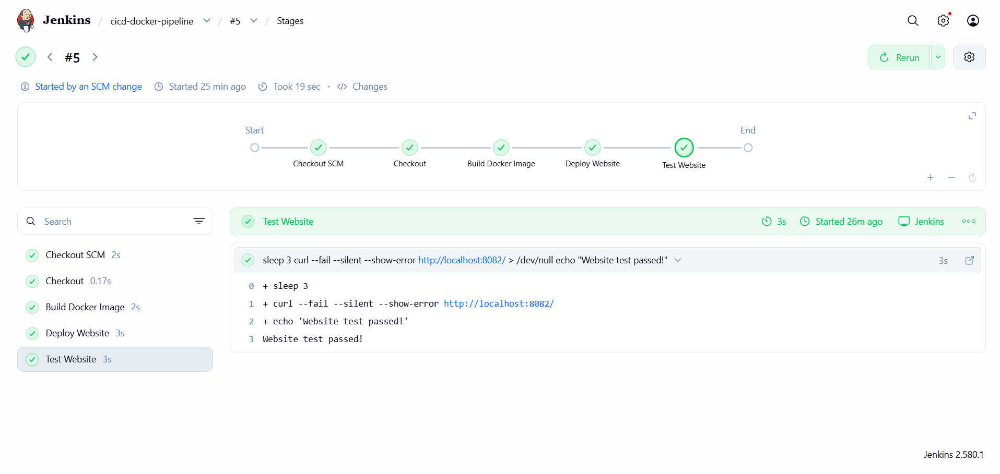
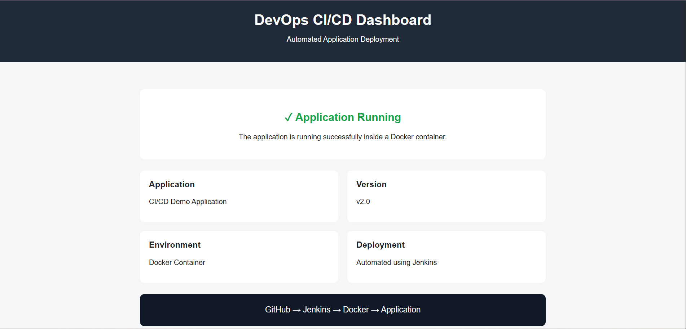

# CI/CD Pipeline with Jenkins and Docker

## Project Overview

This project demonstrates how to automate the build, deployment, and basic testing of a website using Jenkins, GitHub, and Docker.

When I push a code change to GitHub, Jenkins checks the repository for updates, builds a new Docker image, deploys the website, and tests whether it responds successfully.

The project was implemented on a RHEL 9 virtual machine running in VMware.

## Architecture

```text
Developer pushes code
        |
        v
      GitHub
        |
        v
      Jenkins
        |
        v
  Build Docker Image
        |
        v
 Deploy Website Container
        |
        v
   Test Website using curl
        |
        v
   Pipeline Success/Failure
```

## Technologies Used

- **RHEL 9:** Linux operating system for the lab environment
- **Jenkins:** Automates the CI/CD pipeline
- **Git and GitHub:** Source code management
- **Docker:** Builds and runs the application container
- **Nginx:** Serves the website
- **Shell commands:** Used for Docker operations and website testing
- **HTML and CSS:** Used to create the website

## How I Built This Project

### Step 1: Set Up the Environment

- Created a RHEL 9 virtual machine in VMware.
- Installed Docker, Java, and Jenkins.
- Configured Jenkins to run on port `8081` and kept the existing website on port `8080`.

### Step 2: Created the Website

- Created a simple HTML and CSS website.
- Created a `Dockerfile` using the `nginx:alpine` image.
- Configured Docker to copy the website files into Nginx's web directory.

### Step 3: Uploaded the Project to GitHub

- Initialized a Git repository.
- Committed the website files and Dockerfile.
- Pushed the project to GitHub on the `main` branch.

### Step 4: Configured Jenkins

- Created a Jenkins Pipeline job named `cicd-docker-pipeline`.
- Connected Jenkins to the GitHub repository using Pipeline script from SCM.
- Configured Jenkins to read the pipeline instructions from the `Jenkinsfile`.
- Enabled Jenkins to execute Docker commands.

### Step 5: Automated the Build and Deployment

Created pipeline stages to:

1. Retrieve the project files from GitHub.
2. Build the Docker image named `cicd-demo:latest`.
3. Replace the previous pipeline container and start the updated website on port `8082`.

### Step 6: Enabled Automatic Builds

- Configured Jenkins Poll SCM with the schedule `H/2 * * * *`.
- Changed the website title in GitHub and committed the update.
- Verified that Jenkins detected the change and triggered a new build automatically.

### Step 7: Added Website Testing

- Added a `Test Website` stage to the Jenkinsfile.
- Used `curl` to send a request to the deployed website.
- Configured the command to fail the pipeline if the website returns an HTTP error response.
- Verified that the test passed and the pipeline finished successfully.

## Pipeline Stages

| Stage | Purpose |
|---|---|
| Checkout | Retrieves the project and pipeline definition from GitHub |
| Build Docker Image | Builds a Docker image using the Dockerfile |
| Deploy Website | Runs the website in a Docker container |
| Test Website | Checks the website's HTTP response using curl |

## Project Setup

These steps allow you to run the website manually without Jenkins.

### Prerequisites

- Docker installed and running
- Git installed
- Access to the GitHub repository

### 1. Clone the Repository

```bash
git clone https://github.com/adityakpatil04-debug/cicd-docker-project.git
cd cicd-docker-project
```

### 2. Build the Docker Image

```bash
docker build -t cicd-demo:latest .
```

### 3. Run the Website

```bash
docker run -d --name cicd-demo-manual -p 8083:80 cicd-demo:latest
```

### 4. Access the Website

Open the following URL in your browser, replacing the IP with your RHEL machine's current IP address:

`http://<RHEL-VM-IP>:8083`

For example, the lab machine previously used `192.168.139.128`.

### 5. Verify the Container

```bash
docker ps
```

To stop and remove the manually created container:

```bash
docker rm -f cicd-demo-manual
```

## Jenkins Configuration

- **Job Name:** `cicd-docker-pipeline`
- **Pipeline Definition:** Pipeline script from SCM
- **Source Control:** Git
- **Repository Branch:** `main`
- **Pipeline File:** `Jenkinsfile`
- **Build Trigger:** Poll SCM
- **Polling Schedule:** `H/2 * * * *`
- **Deployment Port:** `8082`

Jenkins checks the GitHub repository periodically for changes. This project uses polling rather than a GitHub webhook.

## What This Project Demonstrates

- Configuring Jenkins on Linux
- Integrating GitHub with Jenkins
- Writing a declarative Jenkins pipeline
- Building Docker images automatically
- Deploying a website using Docker and Nginx
- Triggering builds when GitHub changes are detected
- Performing basic automated HTTP testing
- Troubleshooting and verifying pipeline execution

## Project Screenshots

### 1. Jenkins Pipeline



### 2. Deployed Website



